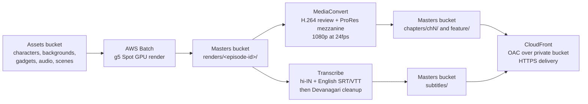

# Architecture: GOLU - Kal Ka Dost AWS production pipeline

This document is the deep dive behind the overview in the
[root README](../README.md). It describes each component as it exists in
[`infra/`](../infra/), shows the per-episode flow and bucket layout, works
through the scale math from the project outline, summarizes the IAM posture,
documents the one provider deviation, and restates the limitations.

Every service and variable named here maps to a real resource in `infra/`. The
pipeline does not invent infrastructure.

## Component by component

### Storage ([`infra/storage.tf`](../infra/storage.tf))

Two S3 buckets, both with versioning enabled, all public access blocked,
server-side encryption (AES256 / SSE-S3), and lifecycle rules:

- **Assets bucket** holds working assets and project files under documented key
  prefixes: `/characters/`, `/backgrounds/`, `/gadgets/`, `/audio/`,
  `/scenes/`, and `/scratch/`. Scratch frames age out after 14 days; noncurrent
  asset versions move to STANDARD_IA at 30 days and expire at 90 days.
- **Masters bucket** holds mastered and delivery outputs under `/chapters/chN/`
  and `/feature/`, with finished render frames landing under
  `/renders/<episode-id>/` before mastering and subtitles under `/subtitles/`.
  Raw renders transition to STANDARD_IA at 7 days and expire at 30 days;
  noncurrent master versions transition STANDARD_IA (30 days) then GLACIER
  (180 days) and expire at 365 days.

Versioning on both buckets satisfies the outline's requirement that S3
versioning be on so masters and project files stay recoverable.

### IAM baseline ([`infra/iam.tf`](../infra/iam.tf))

Two least-privilege roles:

- **Render-job role** (assumed by `ecs-tasks.amazonaws.com`): reads the assets
  bucket, reads and writes the masters bucket under `/renders/*` and
  `/scratch/*` only, and writes CloudWatch Logs scoped to the project's
  `/aws/batch/<name_prefix>*` log group. There is no account-wide `s3:*` and no
  resource `*` where a concrete ARN exists.
- **Pipeline (orchestration) role** (assumed by Lambda and Step Functions):
  submits and terminates Batch jobs on this project's queue and job definition,
  passes the render-job role to Batch (`iam:PassRole` scoped to that one role),
  lists both buckets, and reads renders and writes delivery masters under
  `/chapters/*` and `/feature/*`.

Batch `Describe*` and `List*` actions and the Polly and Transcribe synthesis
actions are not resource-scopable in IAM, so they use resource `*` and are kept
to a narrow action list, each documented in the code.

### Render farm ([`infra/render.tf`](../infra/render.tf))

An AWS Batch managed compute environment on the g5 GPU instance family, a job
queue, and a parameterized container job definition:

- Capacity is EC2 Spot when `use_spot` is true (allocation strategy
  `SPOT_CAPACITY_OPTIMIZED`, bid capped at 100% of on-demand), otherwise
  on-demand EC2. Minimum and desired vCPUs are 0 (scale to zero when idle),
  maximum is `render_max_vcpus`.
- Instance types come from `gpu_instance_types`. The job definition requests 1
  GPU, 4 vCPU and about 15 GiB so a job fits the smallest candidate type
  (`g5.xlarge`, which has 1 NVIDIA A10G GPU).
- Parameters (`episode_id`, `input_prefix`, `output_prefix`, `frame_start`,
  `frame_end`) are substituted into the container command at submit time. The
  container image is `render_container_image`, which is pluggable and
  user-supplied (see Limitations).
- Networking attaches to the account default VPC and subnets via data sources
  with one egress-only security group, so the module is deployable without a
  separate VPC build. A hardened deployment should swap in a dedicated VPC.

### Media and AI services ([`infra/media.tf`](../infra/media.tf))

- **MediaConvert** has an active mastering queue plus two job templates: an
  H.264 1080p24 review master (`.mp4`, QVBR) and a ProRes 422 HQ 1080p24
  mezzanine master (`.mov`). Both author 24fps progressive output; comments
  note the 12fps-on-twos source conformed to a 24fps timeline. The templates
  fix only the codec and mastering settings; the orchestration layer overrides
  the input file and the output destination per submission to target
  `/chapters/chN/` or `/feature/`. A MediaConvert IAM role reads renders and
  assets and writes the chapter and feature deliverables.
- **Amazon Polly** has an IAM role scoped to neural synthesis actions plus S3
  writes limited to the assets `scratch-audio/` prefix. The code documents the
  invocation path (synchronous `synthesize-speech` and asynchronous
  `start-speech-synthesis-task`) with a Hindi neural voice (Kajal, with Aditi as
  a fallback). Polly is scratch only (see Limitations).
- **Amazon Transcribe** has an IAM role that runs transcription jobs, reads the
  audio inputs, and writes subtitles under `/subtitles/`. The documented path
  produces Hindi (hi-IN) and English (en-IN, en-US fallback) SRT and VTT, then a
  Devanagari cleanup post-step (Unicode NFC normalization, danda spacing fixes,
  a project glossary pass for proper nouns, and caption reflow) that runs as a
  small post-processing Lambda or a manual pass.

### Delivery ([`infra/delivery.tf`](../infra/delivery.tf))

A CloudFront distribution fronts the private masters bucket through an Origin
Access Control (SigV4). The bucket stays fully private: a bucket policy grants
`s3:GetObject` only to the CloudFront service with an `AWS:SourceArn` condition
matching this distribution, which is compatible with the bucket's public access
block. Viewers are redirected to HTTPS, the AWS managed CachingOptimized cache
policy is used, and the price class is `PriceClass_200` (Asia including India,
Europe, and North America).

### Monitoring and cost ([`infra/monitoring.tf`](../infra/monitoring.tf))

- An `/aws/batch/<name_prefix>` CloudWatch log group (30 day retention) that the
  render job definition and render role reference.
- An SNS topic with optional email subscriptions (one per
  `budget_alert_emails` entry, so an empty list creates zero subscriptions).
- An AWS Budgets monthly cost budget at `monthly_budget_usd` with four
  notifications (actual and forecast at 80% and 100%), satisfying the outline's
  insistence that budget alarms be on.
- A CloudWatch alarm on failed Batch jobs that notifies the SNS topic, and a
  CloudWatch dashboard summarizing Batch job state for the render queue.

## Per-episode flow and bucket layout



Bucket layout (the masters bucket):

```
s3://<masters-bucket>/
  renders/<episode-id>/          raw render frames (scratch once mastered)
  chapters/
    ch1/                         one prefix per 44 minute broadcast chapter
      mezzanine/                 ProRes 1080p archival master
      review/                    H.264 1080p review master
    ch2/
    ...
    chN/
  feature/                       the feature length cut (same deliverables)
  subtitles/<episode-id>/        Hindi and English SRT and VTT
```

Each `/chapters/chN/` and `/feature/` prefix holds, per the release plan, a
ProRes mezzanine master, a 1080p H.264 review master, and Hindi plus English
subtitle files.

## Scale math and how the Batch settings relate to it

From Section 9 of the project outline, a full feature's worth of the series is
estimated at:

- About **190,080 frames at 24fps** (roughly **95,000 drawings** when animated
  "on 2s", meaning each drawing is held for two frames).
- About **1,600 to 2,200 shots** (cuts).
- Roughly **2,000 to 4,700 GPU-hours** of rendering (about 190,000 frames at
  roughly 40 to 90 seconds per frame on GPU).
- Roughly **$2,000 to $6,000 on Spot** capacity (on-demand would be about two to
  three times that).

How the render farm settings map to those numbers:

- **Spot capacity (`use_spot = true`)** is what makes the $2k to $6k estimate
  realistic. On-demand GPU pricing would push the same work toward the two to
  three times figure, so Spot is the default.
- **`monthly_budget_usd` defaults to 6000**, the top of the Spot range, so the
  Budgets alerts fire before a season's render overruns the outline's ceiling.
- **`render_max_vcpus` defaults to 1024.** Thousands of GPU-hours only finish on
  a sensible calendar if many jobs run in parallel. With `g5.xlarge` at 4 vCPU
  and 1 GPU per job, a 1024 vCPU ceiling allows on the order of 256 concurrent
  single-GPU render jobs, which turns a multi-thousand-GPU-hour season into days
  of wall-clock rendering rather than months. Minimum and desired vCPUs are 0,
  so the pool costs nothing while idle and scales up only when jobs are queued.
- **Larger instance types** (`g5.2xlarge`, `g5.4xlarge`) are candidates in
  `gpu_instance_types` so Batch can pick a bigger node when Spot availability or
  per-job memory calls for it.

The outline also notes a cheaper route (12fps on 2s, 720p, reused background
plates) that roughly halves render hours; that is a creative and payload choice,
and the same infrastructure serves it unchanged.

## MediaConvert provider deviation (documented honestly)

The `hashicorp/aws` provider (v5) exposes `aws_media_convert_queue` but has **no
native resource for MediaConvert job templates**. Rather than drop the required
H.264 and ProRes templates or manage them out of band, this project creates each
template through a small CloudFormation stack
(`aws_cloudformation_stack` wrapping `AWS::MediaConvert::JobTemplate`), which is
the standard Terraform path for AWS resource types the provider does not expose.
The templates remain real, named, Terraform-managed resources and stay in the
state file. One consequence: a job submitter references these templates by name
(`<name_prefix>-h264-1080p-review` and `<name_prefix>-prores-1080p-mezz`) rather
than by a direct Terraform resource attribute.

## IAM and least-privilege summary

- S3 access is pinned to the two concrete bucket ARNs and, where possible, to
  specific key prefixes (`/renders/*`, `/scratch/*`, `/chapters/*`,
  `/feature/*`, `/subtitles/*`, `scratch-audio/*`). There is no account-wide
  `s3:*`.
- The render job can write CloudWatch Logs only under the project's
  `/aws/batch/<name_prefix>*` log group.
- The pipeline role can submit jobs only to this project's queue and definition
  and can pass only the render-job role.
- The CloudFront bucket policy grants read to the CloudFront service only, gated
  by an `AWS:SourceArn` condition, so the masters bucket never becomes public.
- Actions that AWS does not allow to be resource-scoped (Batch describe and
  list, Polly and Transcribe job actions) use resource `*` with a tight action
  list and an inline comment explaining why.

## LIMITATIONS

The same limitations stated in the [README](../README.md#limitations) apply and
are repeated here because they are central to understanding what this repository
is:

- **This infrastructure does not generate finished 3D animated video or neural
  lipsync.** No such tool exists in this environment. The repository is the AWS
  orchestration and scaffolding (storage, GPU scheduling, mastering, subtitles,
  delivery, and cost control) around a render payload that you supply.
- **The creative 3D render and lipsync job is a pluggable container** provided
  through the `render_container_image` variable. The Batch job definition hands
  your container the episode id, input prefix, output prefix, and frame range
  and expects it to read assets from S3 and write rendered frames back to S3.
  The default image value is a placeholder and must be replaced before real jobs
  can run.
- **Amazon Polly voices are for scratch and animatic tracks only, never final.**
  Final character voices and songs are human actors and singers, per the
  outline.
- **The pipeline does not produce finished episodes on its own.** It scales and
  automates the AWS side of production; creative quality depends entirely on the
  render payload and the human performances you bring to it.
